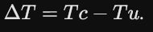
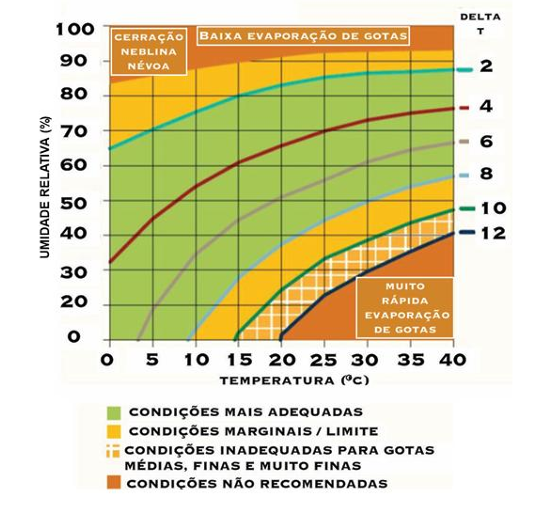

## Classe: `CalcularDelta`

### Visão Geral

Responsável por calcular o índice Delta T, u
m indicador essencial para avaliar se as condições climáticas estão adequadas para a pulverização agrícola. 
No contexto da aplicação, esta classe é invocada durante a criação de um objeto `Clima`, 
e o resultado da operação é salvo diretamente no atributo `deltaT`.

### Fundamentação Teórica

A eficiência e a segurança das operações de pulverização dependem de fatores meteorológicos,
pois estes influenciam a evaporação das gotas e o potencial de deriva.

* O Delta T é uma métrica que sintetiza os efeitos combinados da temperatura e da umidade relativa do ar.

* Seu objetivo é indicar o nível de adequação do clima para maximizar o desempenho dos defensivos aplicados.

* O cálculo é definido pela diferença algébrica 
* entre a temperatura do ar (termômetro de bulbo seco) e a temperatura de bulbo úmido: 

Este indicador reflete o déficit evaporativo da atmosfera:

* **Valores elevados de Delta T:** Indicam que o ar tem maior capacidade de absorver vapor d’água. Isso aumenta a taxa de evaporação das gotas antes que atinjam o alvo, reduzindo a eficiência da aplicação.

* **Valores muito baixos de Delta T:** Apontam condições próximas à saturação atmosférica (alta umidade). Nessas condições, ocorre uma maior persistência das gotas em suspensão, o que eleva significativamente o risco e o potencial de deriva.

Por ser um parâmetro altamente prático, o Delta T é amplamente utilizado em recomendações técnicas, como as da Embrapa, para a identificação de janelas operacionais seguras.

### Detalhamento da Implementação

#### `execute(Double temperatura, Double temperaturaBulboMolhado)`

Este é o método estático principal e único da classe, responsável por aplicar a equação matemática do Delta T.

* **Parâmetros de Entrada:** Recebe a `temperatura` (bulbo seco, do ar ambiente) e a `temperaturaBulboMolhado` (previamente calculada pela classe `CalcularBulboUmido` através do método de bisseção).
* **Retorno:** Retorna um valor `Double` contendo o resultado da subtração simples da temperatura do bulbo úmido em relação à temperatura do bulbo seco, determinando o valor final do Delta T que será usado no motor de decisão da aplicação para gerar alertas de risco.